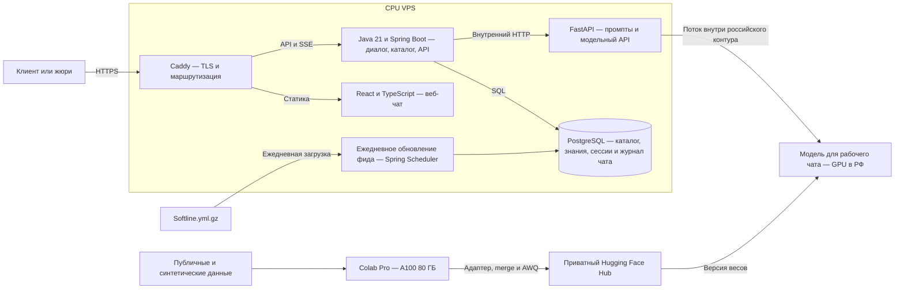
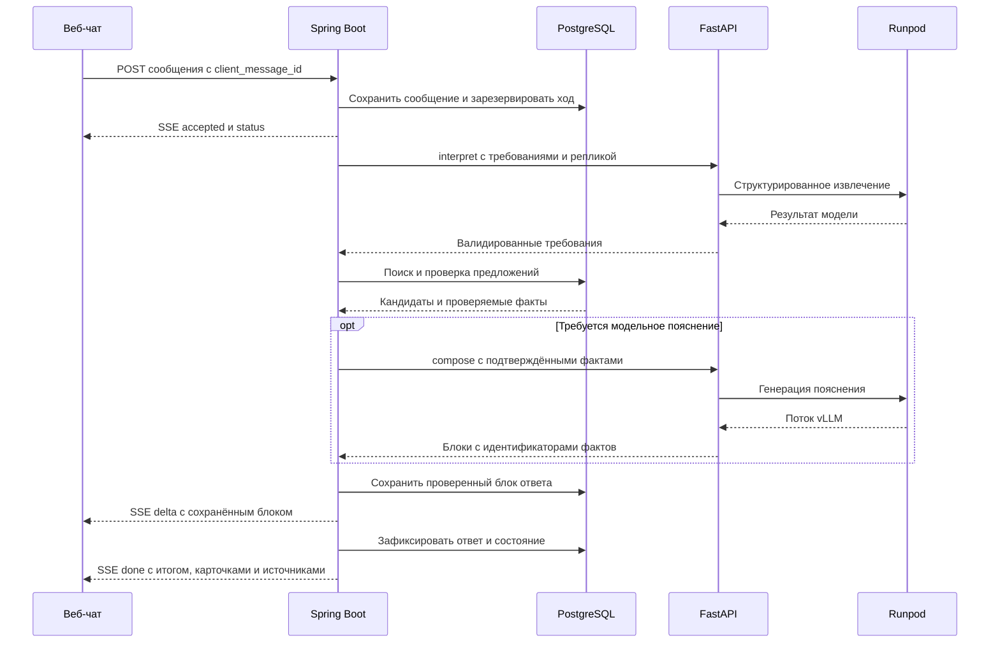

# Архитектура агента поддержки Softline

Документ задаёт общую архитектуру и контракты для фронтенда, бэкенда, БД и ML. Цель хакатона — веб-чат, в котором жюри может подобрать лицензию по названию, описать задачу и получить варианты либо задать вопрос о продукте. Стенд должен быть доступен по HTTPS круглосуточно в течение примерно шести дней проверки. Питч по постановке назначен на **3 декабря 2026 года**. Команде предстоит подтвердить точные даты проверки и режим доступа к стенду.

**Основной бэкенд — Java 21 и Spring Boot.** Он управляет каталогом, диалогом и публичным API. **FastAPI — отдельный внутренний ML-сервис.** Для живых реплик Java, PostgreSQL, FastAPI и модель работают в РФ. Runpod и Colab предназначены для экспериментов с публичным каталогом и синтетическими диалогами. Команда ML определяет размещение GPU для рабочего контура.

Spring Boot сохраняет в PostgreSQL полный журнал реплик пользователя и агента. Раз в сутки сервис загружает актуальный товарный фид Softline и активирует проверенную версию каталога. Новый ход использует активную версию, в том числе в уже открытом диалоге.

## 1. Сценарии и объём релиза

| Сценарий | Успешный результат |
| --- | --- |
| **Клиент знает продукт** | Агент находит семейство или позицию, уточняет критичные параметры лицензии, предлагает подходящее предложение и даёт ссылку на Store. |
| **Клиент описывает задачу** | Агент выясняет требования, подбирает до трёх вариантов или составное решение на нескольких позициях и объясняет соответствие задаче. |
| **Клиент спрашивает о продукте** | Агент отвечает по карточке товара, снимку фида или базе знаний, показывает источник и явно обозначает сведения, которые требуют подтверждения. |
| **Черновик КП** | Опциональная ветка. После явного выбора предложения можно сформировать PDF для проверки менеджером. |

Для демо используем отдельный веб-чат. Виджет на действующем Store, интеграции с CRM и онлайн-оформление заказов относятся к будущему пилоту. В постановке указана ориентировочная нагрузка около 500 обращений в день и матрица около 200 тысяч наименований. Для хакатона проверяем весь предоставленный фид и работу публичного стенда при фактической нагрузке жюри.

## 2. Компоненты и связи



| Владелец | Отвечает за | Передаёт другим командам |
| --- | --- | --- |
| **Frontend** | UI, сессия браузера, поток SSE, карточки, источники, ошибки и восстановление. | Использует публичный контракт. Предоставляет сценарии UX и проверку в браузере. |
| **Backend** | Spring Boot, публичный API, журнал чата, диалог, политика рекомендаций, поиск, ежедневный запуск импорта, лимиты и опциональное КП. | Публикует OpenAPI и примеры SSE. Передаёт в ML минимальный контекст и идентификаторы подтверждённых фактов. |
| **БД и данные** | Миграции, журнал загрузок, нормализация фида, атомарная активация снимка, запросы поиска, резервное копирование. | Передаёт схему, отчёт импорта и воспроизводимые поисковые примеры. |
| **ML** | FastAPI, контракт извлечения требований, промпты, Colab, оценка, артефакт модели и Runpod. | Публикует внутренний OpenAPI, тестовые ответы и результаты оценки по версиям. |

Spring Boot — единственный владелец продуктовых решений и операций с сессией. FastAPI получает текущую реплику целиком и небольшой фрагмент истории для анализа, а для пояснения — текст подтверждённых фактов с их идентификаторами. Сессии, SQL и правила каталога обслуживает Spring Boot.

### Структура репозитория

```text
frontend/                  React, TypeScript, Vite
backend/                   Java 21, Spring Boot, Flyway, импорт и поисковые запросы
ml-service/                Python, FastAPI, Pydantic, клиент Runpod, промпты
ml/                        Ноутбук Colab, подготовка выборки, оценка и экспорт весов
contracts/                 Публичный и внутренний OpenAPI, примеры SSE и тестовые данные
infra/                     Docker Compose, Caddy, конфигурация стенда
ARCHITECTURE.md            Архитектура и решения команды
```

Исходные материалы заказчика остаются в соседней папке `info`. Для локальной разработки импорт принимает путь к смонтированному файлу, на стенде источник задаётся URL в серверной конфигурации. В Git храним код, схемы и небольшие синтетические примеры. ML-артефакты и подготовленный датасет версионируются с указанием происхождения и доступов.

## 3. Данные, БД и поиск

### Источники и ограничения

| Источник | Наблюдение и применение |
| --- | --- |
| [Обновляемый фид Softline](https://store.softline.ru/feeds/Softline.yml.gz) | Основной источник каталога на стенде. Spring Boot раз в сутки загружает `Softline.yml.gz` и проверяет новую версию перед активацией. |
| `info/Mindbox.yml.gz.xml` | Исходный снимок для локального запуска и тестов. XML размером около 292 МБ. Снимок от **25.11.2026, 14:12** содержит **136 040** предложений и **9 311** категорий. У **44 601** предложения `available=true`. У **91 062** позиций пустой `vendorCode`, среди заполненных есть повторы. |
| `info/Базы знаний.docx` | Ссылается на базу знаний Softline и страницу оплаты и доставки. Сохраняем проверенные страницы с исходным URL, заголовком и временем получения. |
| `info/чаты поддержки.zip` | **495** обезличенных записей в трёх TXT. Используем их для формулировок, разметки и оценки. Ответы и действия агента размечаем отдельно. |
| `info/Шаблон КП ПАО Софтлайн.pdf` | Структура черновика КП, поля подтверждения и позиции в табличной форме. |

Источники знаний для импорта. [База знаний Softline](https://docs.softline.com/ru-ru), [Оплата и доставка Store](https://store.softline.ru/delivery_info/)

Правила работы с данными каталога:

- `offer_id` из XML — ключ предложения в пределах снимка. `vendorCode` хранится как необязательный атрибут для точного поиска и вывода. `group_id` связывает варианты товара, когда поле задано. Предложения без группы остаются самостоятельными.
- Храним исходные поля лицензирования и нормализованные значения отдельно. Маркеры вроде «другое или отсутствует» переводим в `null` для структурных фильтров. Пустое поле означает, что значение требует подтверждения.
- Различаем срок лицензии, срок обновлений, срок поддержки, новую покупку и продление. Число пользователей применяется по типу лицензирования. Для пакета на 50 пользователей выводим один пакет соответствующего размера, когда это подтверждено данными о позиции.
- В предложениях используем статус и цену **по версии снимка**. Сохраняем исходную валюту `RUR`, в API отображаем её как `RUB`. Денежные значения храним как `numeric` и передаём десятичной строкой. До уточнения семантики `available=false` такие позиции доступны для справочного поиска, а в подборе предлагаются позиции с `available=true`.
- Признак российского ПО связываем с подтверждённым номером записи в реестре или проверенным источником. Происхождение по имени поставщика, языку и домену не выводим.
- При расхождении данных показываем источник и помечаем спорный параметр как требующий подтверждения. Для фида различаем время снимка, указанное поставщиком, время последней успешной проверки URL и время активации версии в сервисе.

**Проверочный кейс.** Есть 510 предложений семейства MDaemon, в том числе новые лицензии и продления на 50 пользователей. В поле «Версия» этих предложений стоит «другое или отсутствует», а `Standard` отсутствует в названиях. Если пользователь просит именно Standard, агент показывает найденное семейство, уточняет условия и сообщает, что редакцию нужно сверить по карточке продукта или у менеджера. [Каталог MDaemon на Store](https://store.softline.ru/alt-n-technologies-ltd/alt-n-technologies-mdaemon-email-server/)

### Схема PostgreSQL

| Таблица | Ключ и назначение |
| --- | --- |
| `catalog_sync_runs` | `run_id`, дата запуска по Москве, номер попытки, URL, `started_at`, `finished_at`, статус `running` / `unchanged` / `activated` / `failed`, HTTP-статус, код ошибки, `import_id` при загрузке. |
| `catalog_imports` | `import_id`, URL или путь источника, SHA-256, `ETag` и `Last-Modified` при наличии, время снимка, статус, счётчики новых, изменённых и исчезнувших предложений, отчёт валидации. |
| `catalog_head` | Одна запись с `active_import_id`. Указывает на полностью загруженную и проверенную версию. |
| `catalog_categories` | `(import_id, category_id)`, `parent_id`, название, путь категории. |
| `catalog_offers` | `(import_id, offer_id)`, `group_id`, `category_id`, продавец или производитель, `vendor_code`, название, описание, URL, валюта, цена, статус. Нормализованные параметры лицензирования в типизированных полях, оригиналы в `jsonb`. |
| `knowledge_documents`, `knowledge_chunks` | Документы и их фрагменты. Сохраняем ссылку, заголовок, раздел, время получения, хеш содержимого и версию. |
| `chat_sessions` | UUID, хеш токена владельца сессии, состояние требований, выбранное предложение со снимком, служебные даты. |
| `chat_messages` | UUID, `session_id`, роль `user` / `assistant`, полный видимый текст, порядок и время сохранения. У ответа агента ссылка на ход, `status` (`streaming`, `complete` или `partial`) и последний сохранённый `seq`. Завершённый ответ хранит карточки и источники в том виде, в котором они были показаны. |
| `chat_turns` | UUID, `session_id`, `client_message_id`, `request_id`, ссылка на исходную реплику пользователя, версия каталога, статус, дедлайн, `outcome` или код ошибки, версии модели и промпта. Для повтора сохраняем `retry_of_turn_id`. |
| `quote_drafts` | Опционально. Сессия, выбранные позиции и версия снимка, подтверждённые поля расчёта и дата формирования. |

Flyway хранится в `backend` и применяется при выкладке. Используем внешние ключи для версий каталога и категорий, уникальный индекс `(session_id, client_message_id)` и частичный уникальный индекс на одну запись `running` в сессии. Суммы вычисляются в Java через `BigDecimal`. Строки, идентификаторы и данные источников проверяются при импорте.

### Ежедневное обновление фида

1. **Расписание.** Spring Boot запускает проверку раз в сутки. Начальная настройка — **04:00 по Москве** (`0 0 4 * * *`, `Europe/Moscow`), время меняется конфигурацией. При старте после планового времени проверяем, была ли успешная проверка за текущую дату, и догоняем пропущенный запуск. При временном сбое делаем ограниченные повторы с задержкой. Импорт выполняется в отдельном исполнителе с ограниченными ресурсами. Блокировка PostgreSQL исключает два одновременных импорта.
2. **Получение.** Java загружает `Softline.yml.gz` по HTTPS. Используем таймауты загрузки, ограничение размера, временный файл и условный запрос при наличии `ETag` или `Last-Modified` последней успешно проверенной версии. При `304` или совпадении SHA-256 распакованного XML фиксируем `unchanged`. При первой загрузке сверяем структуру и заголовки с VPS, с которого будет идти регулярный импорт.
3. **Подготовка снимка.** Распаковываем gzip и потоково разбираем YML с отключённым DTD и внешними сущностями. Загружаем категории и предложения батчами с новым `import_id`. Сравниваем с активной версией по `offer_id` и считаем добавленные, изменённые и исчезнувшие позиции. Перепроверяем уникальность ключей, связи категорий, цены, URL, число записей и готовность поисковых индексов. Пустой, повреждённый или подозрительно неполный фид оставляем на проверку.
4. **Активация.** Готовая версия и запись `activated` фиксируются одной транзакцией с переключением `catalog_head`. Новый ход читает новый `active_import_id`. Новые товары сразу участвуют в поиске, изменившиеся возвращаются с новыми полями, а исчезнувшие уходят из выдачи. Поиск использует PostgreSQL и готовые индексы этой версии, поэтому смена модели, переобучение и перезапуск приложения для обновления товаров не требуются.
5. **Сбой и восстановление.** Ошибку записываем в `catalog_sync_runs`, а чат продолжает использовать последний успешный снимок. После перезапуска владелец блокировки отмечает прерванную попытку как `failed` и при необходимости повторяет проверку. Оператор видит время последней успешной проверки, время активного снимка, число изменений и причину сбоя. При пропущенном суточном цикле выдаём сигнал оператору. Предыдущий успешный снимок сохраняем для отката. Снимки, использующиеся активными ходами, сохраняются до их завершения. Устаревшие строки каталога можно удалить отдельно от метаданных импорта и сохранённых карточек чата.

[Рабочий URL фида](https://store.softline.ru/feeds/Softline.yml.gz), [планировщик Spring](https://docs.spring.io/spring-framework/reference/integration/scheduling.html), [блокировки PostgreSQL](https://www.postgresql.org/docs/current/explicit-locking.html)

### Поиск по активному снимку

1. Известный товар ищем по точному идентификатору, артикулу, производителю, названию и алиасам. Для поиска по задаче используем категории, фильтры и полнотекстовый индекс. `pg_trgm` помогает при опечатках и вариантах написания. Сравниваем планы запросов на полном фиде.
2. Backend сначала проверяет обязательные ограничения. Совпадающие кандидаты сортируются по релевантности и полноте подтверждения. Если поле обязательное, но неизвестное, позиция может появиться с явной отметкой «требует проверки». Для составного решения проверяем покрытие каждого требования и перечисляем его отдельными позициями.
3. Каждый ход фиксирует активный снимок на момент начала. Следующий ход в той же сессии снова читает активную версию. При продолжении разговора о ранее показанной позиции Java проверяет её по текущей версии. Прошлая карточка показывает данные на момент ответа. Выбор предложения и создание КП проверяют действующую цену, наличие и параметры. При существенном изменении интерфейс просит подтвердить обновлённое предложение или выбрать другое.
4. Фрагменты базы знаний и карточек загружаем заранее из согласованных источников. В рантайме передаём в ML только релевантные фрагменты. Если текстовый поиск пропускает нужные товары или ответы, оцениваем гибридный поиск с embeddings на отдельном прогоне. При добавлении такого индекса включаем его обновление в подготовку снимка.
5. Если точного совпадения нет, используем нормализованный запрос `product_query` из ML. Java повторяет поиск по алиасам и похожим названиям в том же снимке. Если нашлось только семейство, агент уточняет редакцию или артикул. Подтверждённые альтернативы показываем как замену с объяснением различий, когда клиент готов их рассмотреть. Если подходящих предложений или подтверждений нет, возвращаем `insufficient_data` и указываем, что нужно уточнить. Запросы на проверку документов и поставку вне каталога в демо помечаем как требующие подтверждения менеджером. Фактическое назначение сотрудника требует канала передачи в будущем пилоте.

Документация по PostgreSQL. [Полнотекстовый поиск](https://www.postgresql.org/docs/current/textsearch.html), [`pg_trgm`](https://www.postgresql.org/docs/current/pgtrgm.html)

## 4. Backend и ход диалога

Spring Boot использует Spring MVC, типизированные DTO, доступ к PostgreSQL через JDBC и Flyway. Внешний SSE обслуживает `SseEmitter` с явно ограниченными временем и количеством параллельных диалогов. Чтение внутреннего потока вынесено из потока обработки HTTP-запроса. Отдельные короткие транзакции резервируют и завершают ход. Поиск и вызовы ML происходят между ними. [Асинхронные запросы Spring MVC](https://docs.spring.io/spring-framework/reference/web/webmvc/mvc-ann-async.html), [HTTP-клиенты Spring](https://docs.spring.io/spring-framework/reference/integration/rest-clients.html)

1. Проверяем сессию, вход и `client_message_id`. Сохраняем сообщение пользователя и резервируем ход. Фиксируем версию фида и общий дедлайн.
2. Формируем ограниченный контекст из текущей реплики, состояния и нескольких релевантных предыдущих сообщений. Отправляем его в FastAPI для определения намерения и извлечения требований.
3. Проверяем изменения состояния. Явная поправка пользователя заменяет предыдущее значение. Операции над полями допускаются только из схемы. При конфликте критичных требований задаём короткое уточнение. При ответе на справочный вопрос сохраняем текущий подбор, когда он остаётся применим.
4. Выполняем поиск по каталогу или базе знаний. Проверяем обязательные ограничения и формируем перечень фактов и ссылок для ответа. Если данных достаточно, собираем карточки и объяснение. При пробеле уточняем требования или показываем доступные сведения с оговоркой.
5. Карточки и коммерческие формулировки о цене, единице продажи и наличии собираем в Java из проверенных данных. Для пояснений передаём FastAPI только отобранные факты. Spring Boot проверяет ссылки на факты и соответствие карточек найденным предложениям. Сохраняем проверенный текстовый блок в журнале перед отправкой `delta`. При сбое `compose` коротко дополняем уже сохранённый текст подтверждёнными фактами, если этого достаточно для ответа. При сбое `interpret` сохраняем исходную реплику и возвращаем возможность повтора.
6. В одной транзакции отмечаем ответ завершённым, сохраняем показанные карточки и источники, обновляем состояние и завершаем ход. Только после фиксации отправляем `done`. При сетевом обрыве следующий `GET` показывает сохранённое состояние.

В диалоге используем три намерения `known_product`, `needs_solution`, `product_question`. Отдельно от намерения храним результат шага `clarify`, `recommend`, `answer`, `insufficient_data`. Показанные предложения сохраняются с версией снимка. Изменение требований сбрасывает выбранную позицию, когда она перестаёт им соответствовать.



### Повторы и сбои

- Один активный ход на сессию. Если клиент повторил тот же `client_message_id` с тем же телом, возвращаем результат существующего хода. Для `running` возвращаем `409 TURN_IN_PROGRESS` с `turn_id` и предлагаем фронту прочитать состояние. Если ID повторён с другим телом, возвращаем `409 IDEMPOTENCY_CONFLICT`.
- Для обработки второй попытки после сохранённой ошибки UI отправляет новый `client_message_id` и `retry_of_turn_id`. Backend проверяет, что исходный ход завершился ошибкой и принадлежит сессии, и переиспользует исходное сообщение пользователя. В истории отображается одна пользовательская реплика.
- Просроченный `running` переходит в `failed` при старте приложения, чтении затронутой сессии и перед резервированием нового хода в ней. В той же транзакции переводим связанный ответ из `streaming` в `partial`, если он уже записан. Завершение старого хода проверяет его идентификатор, текущий статус и дедлайн. Это позволяет продолжить диалог после рестарта без поздней перезаписи состояния.
- Если браузер оборвал соединение, пытаемся закрыть внутренний поток и отменить запрос к модели, если способ вызова это поддерживает. Фронтенд восстанавливает состояние через сессию. Таймаут и ошибки Runpod фиксируем по `request_id` и `turn_id`.

### Журнал всех вопросов и ответов

- **Spring Boot → PostgreSQL.** Сохраняем текст каждой принятой реплики пользователя, каждого ответа и уточняющего вопроса агента, включая шаблонные ответы. Реплика пользователя фиксируется до поиска и вызова ML. Журнал хранит роли, порядок, время, связь с сессией и ходом. У ответа сохраняются точный текст, карточки и ссылки из публичного API. Через `chat_turns` доступны использованные версии каталога, промпта и модели.
- **Стриминг.** Проверенный блок с номером `seq` дописываем к ответу перед выдачей в браузер. Запись блоков привязана к текущему `running` ходу. Если стрим завершился ошибкой после выдачи текста, отмечаем сохранённый ответ `partial` и привязываем ошибку к ходу. Фронт показывает, что ответ прерван. Для дальнейшего контекста модели используем завершённые ответы и пользовательские реплики.
- **Повторы.** Сетевой повтор с тем же `client_message_id` читает существующий результат. При явном повторе после ошибки новый ход ссылается на ту же пользовательскую реплику. Оба ответа, в том числе частичный, остаются в журнале со своими статусами. Если ошибка произошла до первого блока, у хода сохраняется её код.
- **Доступ и хранение.** Браузер видит историю своей сессии. Команда читает журнал через ограниченный доступ к БД, а выгрузки для оценки выполняются отдельно с обезличиванием. Технические логи Spring Boot, FastAPI и Runpod содержат идентификаторы, тайминги и ошибки. Полный текст диалога хранится в прикладном журнале. Срок хранения и доступ к выгрузкам согласуем перед проверкой. Резервная копия PostgreSQL включает журнал.

## 5. Публичный API и Frontend

Публичный API начинается с `/api/v1`. Браузер использует тот же origin, что сайт. Сессия связывается с серверным токеном в cookie `HttpOnly`, `Secure`, `SameSite=Lax`. Для изменяющих запросов Spring Boot проверяет `Origin`. Выбранные карточки и ссылки привязаны к сессии. Доступ жюри по открытому URL или через пароль согласуем отдельно.

| Метод | Путь | Результат |
| --- | --- | --- |
| `POST` | `/api/v1/sessions` | `201`, UUID новой сессии и cookie при первом обращении. |
| `GET` | `/api/v1/sessions/{session_id}` | История с отметкой частичного ответа, выбранная позиция и состояние последнего хода. Используется при перезагрузке и обрыве SSE. |
| `POST` | `/api/v1/sessions/{session_id}/messages` | При валидном запросе `200 text/event-stream`. Ошибки входа и доступа возвращаются как JSON до открытия потока. |
| `POST` | `/api/v1/sessions/{session_id}/selection` | Фиксирует выбор одной из предложенных позиций по `offer_id` и `catalog_version`. Доступен в состоянии без активной генерации. |
| `POST` | `/api/v1/sessions/{session_id}/quote-drafts` | Опционально. Формирует черновик КП по явно выбранной позиции, возвращает `200 application/pdf` с именем файла. |
| `GET` | `/health/live`, `/health/ready` | Готовность Spring Boot и локальных зависимостей. Проверки работают без запуска GPU. |

Тело запроса сообщения содержит `client_message_id` (UUID), `text` (строка) и необязательный `retry_of_turn_id` (UUID). При повторе после сбоя `text` совпадает с исходной репликой. Успешный селектор принимает `offer_id` и `catalog_version`. Фронтенд получает признак `quotes_enabled` при чтении сессии. Скачивание PDF доступно только владельцу сессии.

```json
{
  "client_message_id": "cbdc24f2-cb42-472f-ac4c-fbcf170e7839",
  "text": "Нужна новая лицензия MDaemon на 50 пользователей"
}
```

Ошибки до открытия SSE имеют поля `code`, `message`, `request_id` и, когда применимо, `turn_id`. Для отсутствующей или чужой сессии используем `404`, для невалидного ввода — `400`, для занятых ходов и конфликта ID — `409`, для превышения лимита — `429`. Выбор позиции и КП возвращают `409 OFFER_CHANGED` при существенном изменении, включая исчезновение из активного фида, и обновлённую карточку, если позиция ещё доступна. Ошибки после открытия потока приходят через `failed`.

### События SSE

| Событие | Поля `data` | Использование |
| --- | --- | --- |
| `accepted` | `turn_id`, `client_message_id`, `user_message_id`, `request_id` | Связать локальную реплику с ходом на сервере. |
| `status` | `stage` из `interpreting`, `searching`, `generating` | Показать состояние хода. Во время `interpreting` при долгом ожидании показать «Ожидаем ответа модели». |
| `delta` | `seq`, `text` | Добавить проверенный текстовый блок в текущий черновик ответа. |
| `done` | `turn_id`, `outcome`, `message` | Заменить черновик сохранённым ответом. `message` содержит `id`, `role`, `text`, `cards`, `sources`, `created_at`. |
| `failed` | `turn_id`, `code`, `message`, `retryable` | Завершить индикатор, сохранить реплику пользователя и предложить повтор, когда он доступен. |

Формат карточки `offer_id`, `catalog_version`, `name`, `product_url`, `price`, `availability`, `attributes`, `source_ids`. `price` — либо `null`, либо объект с `amount` десятичной строкой и `currency`. Для `availability` используем `available`, `unavailable`, `unknown`. Источник содержит `id`, `title`, `url`, `kind` и время снимка или проверки. Ссылки привязываются сервером к карточкам и фактам. Примеры полной схемы и ошибочных ответов размещаем в `contracts/`.

Пример потока для уточнения. Каждое событие оканчивается пустой строкой.

```text
event: accepted
data: {"turn_id":"e3d1701c-1210-4706-94cb-2b9ec088da3d","client_message_id":"cbdc24f2-cb42-472f-ac4c-fbcf170e7839","user_message_id":"5e3e37eb-4f4c-4d5a-aab7-25816a8d1057","request_id":"req-0042"}

event: status
data: {"stage":"searching"}

event: delta
data: {"seq":1,"text":"Какой срок лицензии вам нужен?"}

event: done
data: {"turn_id":"e3d1701c-1210-4706-94cb-2b9ec088da3d","outcome":"clarify","message":{"id":"53276bcc-4792-4db3-8a03-2ebc37f5b33b","role":"assistant","text":"Какой срок лицензии вам нужен?","cards":[],"sources":[],"created_at":"2026-11-27T09:00:00Z"}}
```

Фронт открывает SSE с помощью `fetch` на POST и разбирает события по границам SSE, поскольку поток содержит JSON-тело запроса. Соединение закрывается по `done` или `failed`. Spring отправляет heartbeat-комментарии во время ожидания, а Caddy передаёт `text/event-stream` без задержки буферизации. При обрыве фронт читает сохранённую сессию и при необходимости коротко опрашивает состояние активного хода. Ответ из БД является окончательным. [SSE в Spring MVC](https://docs.spring.io/spring-framework/reference/web/webmvc/mvc-ann-async.html), [Проксирование в Caddy](https://caddyserver.com/docs/caddyfile/directives/reverse_proxy)

### Что реализует фронтенд

- Экран чата с началом нового диалога, историей, вводом, кнопкой отправки, отображением процесса и состоянием ошибки. Отправку следующей реплики блокируем до завершения текущего хода. После обрыва восстанавливаем сохранённый текст и показываем статус частичного ответа либо завершённый результат.
- Карточки с названием, ценой и статусом по снимку, существенными параметрами и ссылкой на Store. Неизвестные параметры отмечаются как требующие проверки. Ссылки на источники видны рядом с ответом.
- Сообщения и блоки отображаются безопасным текстом или санитизированным Markdown. Ссылки из контрактных полей проходят проверку схемы URL. Для восстановления сохраняем UUID текущей сессии в браузере, а доступ подтверждает серверная cookie.
- Для параллельной работы фронт использует примеры SSE из `contracts/` для уточнения, рекомендаций и ошибки. После подключения API проверяем десктоп, мобильный экран, обрыв соединения, обновление и повтор хода.

## 6. Внутренний сервис FastAPI

FastAPI работает во внутренней сети с доступом к модели в РФ. Spring Boot обращается к нему по имени сервиса. Внутренние запросы передают `request_id`, остаток дедлайна в миллисекундах и сервисный токен в `Authorization: Bearer`. Сервис ограничивает конкурентные вызовы. Публичные входы, состояние диалога и поиск обслуживает Java.

| Маршрут | Вход | Выход |
| --- | --- | --- |
| `POST /internal/v1/interpret` | `request_id`, `deadline_ms`, `text`, `conversation_context`, `requirements` | JSON с `intent`, `product_query`, `updates`, `clarification_candidates` и версией модели. |
| `POST /internal/v1/compose` | `request_id`, `deadline_ms`, `outcome`, `facts`, `language` | SSE `block` с `text` и `fact_ids`, затем `complete`. В случае ошибки возвращает `failed` или HTTP-ошибку до открытия потока. |
| `GET /health/live`, `GET /health/ready` | Локальные проверки процесса и загрузки конфигурации. | Состояние FastAPI. Проверка модели выполняется отдельным smoke-запросом. |

Например, клиент пишет «Подойдёт ли найденная лицензия на 50 человек?». `interpret` получает эту реплику целиком, требования и несколько релевантных предыдущих сообщений. После поиска Java передаёт в `compose` факт `{"id":"f1","text":"Лицензия рассчитана на 50 пользователей"}`. В готовом блоке ML возвращает текст пояснения и `fact_ids: ["f1"]`. Java проверяет, что такой факт входил в текущий запрос, и связывает его с карточкой или статьёй для ссылки в чате. Ссылка на факт показывает, на какие данные опирается пояснение. Сам текст проверяется отдельно.

`interpret` возвращает типизированные операции `set` и `clear` для полей `product_name`, `edition`, `license_kind`, `seats`, `license_term_months`, `deployment`, `platform`, `budget_rub`, `domestic_required`, `use_case`. Для `set` передаём значение и короткий фрагмент пользовательской реплики, подтверждающий изменение. `license_kind` принимает `new` или `renewal`, количество мест и срок — положительные целые числа, бюджет — десятичную строку, требование к реестру — логическое значение. `clear` снимает ранее заданное требование. Spring Boot применяет правила приоритетов и проверяет значения. `clarification_candidates` — список полей, по которым модель предлагает спросить уточнение.

Пример ответа `interpret` на сообщение выше.

```json
{
  "intent": "known_product",
  "product_query": "MDaemon",
  "updates": [
    {"op":"set","field":"product_name","value":"MDaemon","evidence":"MDaemon"},
    {"op":"set","field":"license_kind","value":"new","evidence":"новая лицензия"},
    {"op":"set","field":"seats","value":50,"evidence":"50 пользователей"}
  ],
  "clarification_candidates": ["license_term_months"],
  "model_version": "qwen3-32b-awq-base"
}
```

`compose` принимает готовые факты с компактными `id`, `kind` и значениями. Текст карточки и ссылки отображаются из Java. Для модельного пояснения буферизуем законченный блок, проверяем идентификаторы, формат и конкретные цены или параметры перед выдачей в браузер. Наличие ссылки на факт помогает проверке. Смысловую точность пересказа дополнительно оцениваем на контрольных диалогах.

Промпты, контракты Pydantic и код нормализации ответа версионируются вместе. На выбранном образе Runpod отдельно проверяем передачу `response_format` и `chat_template_kwargs`. По поддерживаемому пути применяем JSON Schema, иначе FastAPI запрашивает строгий JSON, валидирует его и возвращает типизированную ошибку при нарушении схемы. Для `compose` HTTP-клиент получает поток от vLLM и преобразует его в проверяемые блоки. [SSE в FastAPI](https://fastapi.tiangolo.com/tutorial/server-sent-events/), [Structured Outputs в vLLM](https://docs.vllm.ai/en/latest/features/structured_outputs/), [OpenAI-совместимый интерфейс Runpod](https://docs.runpod.io/serverless/vllm/openai-compatibility)

## 7. ML и жизненный цикл модели

Конфигурации Runpod, Colab и Hugging Face ниже относятся к экспериментам на публичных и синтетических данных. Для реальных обращений заказчика необходим подтверждённый российский контур, включая вычисление, сохранение журнала и резервные копии.

### Обучение и оценка

1. **Базовый релиз.** Сначала поднимаем официальный `Qwen/Qwen3-32B-AWQ` на Runpod и проверяем два вызова из FastAPI. На контроле также сравниваем прежнего кандидата `Qwen2.5-14B-Instruct`. Он нужен для оценки выигрыша от перехода на 32B. [Qwen3-32B](https://huggingface.co/Qwen/Qwen3-32B), [Официальная Qwen3-32B-AWQ](https://huggingface.co/Qwen/Qwen3-32B-AWQ)
2. **Подготовка выборки.** Из обращений размечаем намерение, требования, допустимое следующее действие и ожидаемое уточнение. Для кейсов по каталогу добавляем версию фида, идентификаторы подходящих предложений и подтверждающие факты. Проверяем остаточные персональные данные и условия использования материалов в облаке. Похожие обращения группируем до разбиения. Контрольную выборку замораживаем до начала настройки промптов и обучения.
3. **QLoRA.** В Colab Pro на **A100 80 ГБ** берём оригинальный `Qwen/Qwen3-32B` и загружаем модель в тренировочном 4-битном формате Unsloth. Стартовый контекст 2–4 тыс. токенов. Короткий прогон проверяет пиковую VRAM, скорость и сохранение адаптера. График полного обучения рассчитываем по числу токенов, измеренной скорости и времени на экспорт. [Unsloth для Qwen3](https://unsloth.ai/blog/qwen3), [Ограничения Colab](https://research.google.com/colaboratory/faq.html)
4. **Экспорт.** Сохраняем адаптер, ревизию базы и токенизатора. Выполняем merge в 16 бит, затем отдельную AWQ-квантизацию с калибровочными промптами, репрезентативными для чата. Для merge и AWQ заранее проверяем свободный диск, оперативную память и отдельный бюджет времени. Записываем версии датасета, кода, промптов, образа vLLM и итогового артефакта. [Экспорт Unsloth](https://huggingface.co/docs/trl/v0.25.1/unsloth_integration), [Квантизация AWQ](https://docs.vllm.ai/projects/llm-compressor/en/latest/examples/awq/)
5. **Проверка релиза.** Сравниваем базовую 14B, базовую 32B, дообученную 32B и финальный AWQ-артефакт на одних и тех же подходящих кейсах. Для вывода об эффекте дообучения сравниваем 32B до и после на одинаковых входах и режиме генерации, а эффект квантизации оцениваем отдельным прогоном. Улучшение целевых ошибок и прохождение сквозных проверок дают основание переключить стенд на обученный артефакт.

### Артефакт и Runpod

| Параметр | Решение |
| --- | --- |
| Хранилище | Приватный HF-репозиторий с версионированным AWQ-артефактом, токенизатором, конфигурацией и метаданными релиза. |
| API | Runpod vLLM, `https://api.runpod.ai/v2/<endpoint_id>/openai/v1` как `base_url`, ресурс `chat/completions`. |
| GPU | **L40S 48 ГБ** как стартовая конфигурация для 32B AWQ. Измеряем загрузку весов, KV-cache и задержку на ограниченном контексте. |
| Масштабирование | **Min Workers 0, Max Workers 1**. Стартовый idle timeout **15 секунд**, затем решение по замеру многоходовых диалогов. |
| Генерация | Начинаем с режима без thinking для обычных реплик. Проверяем передачу параметра на реальном образе и ограничиваем длину входа и ответа. |
| Версии | Храним проверенный базовый артефакт и обученную AWQ-версию. Конфигурация ML задаёт endpoint, имя модели и версию релиза. Откат — возврат на проверенный профиль с контрольным запросом. |

Токен HF с правом чтения модели храним в секрете Runpod. Ключ Runpod хранится в окружении FastAPI на VPS. Базовый и обученный профили используем для оценки и отката, на внешнем стенде выбирается один профиль. Первым тестом проверяем холодный старт приватного артефакта после масштабирования до нуля, включая модельный кэш. [Кэш Runpod](https://docs.runpod.io/serverless/endpoints/model-caching), [Настройки vLLM в Runpod](https://docs.runpod.io/serverless/vllm/environment-variables), [Настройки воркеров](https://docs.runpod.io/serverless/endpoints/endpoint-configurations)

## 8. Развёртывание, доступность и бюджет

- **VPS.** Стартовая конфигурация 2–4 vCPU, 4–8 ГБ RAM и 20–30 ГБ SSD. После импорта измеряем размер БД с индексами, запас на следующий снимок и резервную копию. Caddy обслуживает порты 80/443, раздаёт сборку React и проксирует `/api/` и `/health/` в Spring Boot. Spring Boot, FastAPI и PostgreSQL общаются в сети Compose через порты внутри Docker. Том PostgreSQL и каталог импортов сохраняются между релизами.
- **Выкладка.** Собираем образы, применяем миграции, проверяем готовность локальных сервисов, активируем проверенный каталог и выполняем smoke-тест через публичный HTTPS URL. На VPS проверяем исходящий доступ к фиду, импортируем первую версию и включаем ежедневное расписание через `CATALOG_FEED_URL`, `CATALOG_SYNC_CRON` и `CATALOG_SYNC_ZONE`. Тестируем перезапуск сервисов и восстановление БД с журналом из резервной копии до открытия стенда. Автоматический перезапуск помогает при падении процесса. VPS, сеть и доступность GPU остаются внешними зависимостями.
- **GPU и таймауты.** Бюджет холодного хода — **120 секунд**, обычного — **90 секунд**. Java выбирает холодный бюджет при первом обращении и после настраиваемой паузы с последнего успешного ответа FastAPI. Бюджет хода включает оба модельных вызова и поиск. Остаток времени передаём в FastAPI. Бэкенд отправляет SSE heartbeat каждые 8 секунд ожидания. На стенде сверяем таймауты прокси, браузера и модели. Проверяем первый запрос после простоя и следующий запрос на прогретой модели. Публичная готовность стенда и периодические HTTP-проверки используют локальные health endpoints. Пробный вызов модели запускается отдельно.
- **Бюджет.** Runpod тарифицирует инициализацию, выполнение и ожидание до выключения. При ставке L40S `$0.00053/с` 20–30 тарифицируемых минут стоят около `$0.64–0.95` за GPU. Это пример расчёта. Расход за шесть дней зависит от реального числа стартов и запросов. Настраиваем лимиты запросов по IP и сессии, общий предел параллельных ходов, длину входа и output tokens. Перед открытием проверяем баланс и уведомление о его снижении. [Ставки Runpod](https://docs.runpod.io/serverless/endpoints/endpoint-configurations), [Тарификация](https://docs.runpod.io/serverless/pricing)
- **Защита данных.** Используем HTTPS, закрытую сеть для БД и FastAPI, серверные секреты и минимизацию контекста при передаче в облако. Доступ к журналу и резервным копиям ограничиваем. Срок хранения истории и доступ к выгрузкам согласуем до публичного запуска.
- **Наблюдаемость.** Протягиваем `request_id` от Spring Boot до FastAPI, связываем его с `turn_id` и идентификатором запроса провайдера, когда он доступен. Снимаем время поиска, ожидание первого токена Runpod, время первого видимого блока, длительность хода, ошибки и число запросов. Холодный старт отмечаем по контролируемому тесту или сигналу провайдера. Для импорта проверяем время последней успешной загрузки или `unchanged`, возраст активного снимка и изменения по последней активации.

## 9. Опциональный черновик КП

Spring Boot формирует черновик из подтверждённой выбранной позиции. Перед расчётом фиксируем действующий снимок, сверяем наличие, цену и единицу продажи, а при существенном изменении запрашиваем новое подтверждение. Выводим юридическое название заказчика, дату, артикул при наличии, наименование, количество, цену, сумму и итог. Поля НДС, оплаты, поставки и срока действия заполняем подтверждёнными значениями. При пробелах оставляем поля для менеджера. PDF маркируется «Черновик». Запрос и скачивание привязаны к владельцу сессии.

## 10. Приёмка и интеграционный план

### Контрольные проверки

| Проверка | Что фиксируем |
| --- | --- |
| Поиск известного товара | Правильное семейство, неподтверждённая редакция Standard, выбор между новой лицензией и продлением, учёт числа пользователей. |
| Подбор по задаче | Уточнения для защиты почты и файлов на 50 сотрудников, фактическое покрытие требований, подтверждение статуса российского аналога по источнику. |
| Вопрос о продукте | Корректный ответ со ссылкой, корректная обработка неизвестной характеристики и расхождения данных. |
| ML и каталог | Точность полей требований, валидный JSON, уместность уточнений, `Recall@10` поиска по размеченным примерам, доля рекомендаций с подтверждёнными фактами. |
| Ежедневный импорт | Переключить каталог с версии A на B с добавленной, изменённой и удалённой позициями. Новый ход в той же сессии использует B, прежний ответ сохраняет карточку из A. При сбое и при повторе файла чат работает с последним проверенным снимком. |
| Журнал чата | Сохранить пользовательский вопрос, уточнение агента, завершённый ответ и карточки. Повторить запрос с тем же ID, прервать поток после блока и сверить сохранённый статус после перезагрузки. |
| Надёжность | Холодный и тёплый Runpod, два одновременных запроса, повтор сообщения, обрыв потока, восстановление истории, рестарт VPS, откат версии модели. |
| Публичный стенд | HTTPS, открытие на мобильном и десктопе, корректная индикация ожидания, плавная выдача проверенных блоков, активные ссылки. |

Критерий готовности к показу — оба сценария подбора и ответ на вопрос проходят по HTTPS-адресу стенда на зафиксированных версиях. В демо-кейсах каждое коммерчески существенное утверждение связано с записью каталога или другим подтверждающим источником. Пробелы явно помечены. Для измерений собираем отдельные результаты холодного и тёплого старта и сравнение базовой и дообученной 32B. Если готов черновик КП, включаем его в прогон отдельным шагом.

### Порядок работ

| До | Frontend | Backend и БД | ML |
| --- | --- | --- | --- |
| **27 ноября** | Согласовать состояния интерфейса и примеры SSE. | Закрепить API, схему журнала и загрузок, проверить URL фида и подготовить первый снимок. | Поднять официальный 32B AWQ на Runpod, замерить первый вызов из FastAPI и проверить схему ответа. |
| **29 ноября** | Подключить чат, карточки, ссылки и восстановление. | Соединить поиск, сессии и журнал, настроить ежедневный импорт и поднять HTTPS-стенд. | Подготовить разметку, базовые метрики и короткий прогон QLoRA на A100. |
| **1 декабря** | Проверить крайние состояния и мобильный интерфейс. | Довести ответы по знаниям, таймауты и проверку результата. При свободном времени подключить КП. | Сравнить базу, адаптер и AWQ, проверить приватный артефакт и выбрать версию для релиза. |
| **2–3 декабря** | Репетиция публичного демо. | Проверить восстановление, баланс стенда, лимиты, данные и критерии приёмки. | Зафиксировать версии, повторить замеры после простоя и проверить откат. |

### Решения, которые требуют подтверждения

1. **Организаторы и команда.** Точные даты шестидневной проверки, правила доступа к стенду и приоритетные категории демо.
2. **Заказчик.** Семантика `available=false`, приоритет при расхождении фида и Store, время публикации ежедневного фида и разрешённый состав данных для Colab и Runpod.
3. **Команда.** Владельцы VPS, домена, Runpod и приватного HF-репозитория, бюджет, срок хранения журнала и обязательность КП для своей презентации.
4. **По результатам замеров.** Размер диска VPS, таймаут холодного старта, конкретный образ воркера, idle timeout и итоговый релиз модели.

## 11. Материалы заказчика

Файлы находятся в `info` рядом с корнем репозитория в общем рабочем каталоге команды.

- [Постановка «ИИкузница — Агент поддержки»](<../info/ИИкузница_—_Агент поддержки.pdf>)
- [Ежедневный фид Softline](https://store.softline.ru/feeds/Softline.yml.gz)
- [Локальный снимок фида Mindbox](../info/Mindbox.yml.gz.xml)
- [Перечень баз знаний](<../info/Базы знаний.docx>)
- [Архив чатов поддержки](<../info/чаты поддержки.zip>)
- [Шаблон КП ПАО Софтлайн](<../info/Шаблон КП ПАО Софтлайн.pdf>)
